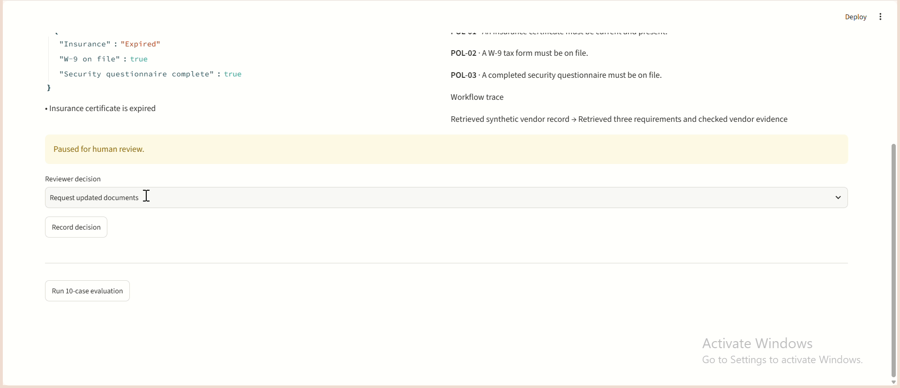
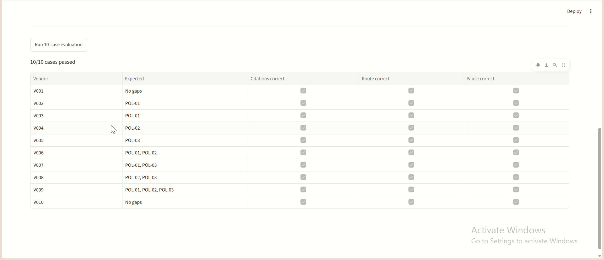

# Vendor Onboarding Review Agent

A small LangGraph workflow for reviewing vendor submissions against fictional
onboarding requirements. It retrieves policies by keyword overlap, applies
deterministic checks to structured records, cites the policies, and pauses at
a human review checkpoint if documentation is missing, incomplete, or expired.

## Run in VS Code on Windows

Open this folder and run in PowerShell:

```powershell
py -3 -m pip install -r requirements.txt
py -3 -m streamlit run app.py
```

Open the local URL shown in the terminal. No API key or Ollama download is
required. This version demonstrates the retrieval and orchestration pieces
of agentic RAG with deterministic decisions. It does not call an LLM or
implement MCP. The in-memory checkpoint lasts for the app process.

## Demo

1. Select V002 and click **Run review**. An expired certificate triggers the
   human review gate and the dashboard shows policy POL-01.
2. Choose **Request updated documents** and click **Record decision**.
3. Select V001 and run it to show the clear-evidence route.
4. Click **Run 10-case evaluation** to compare citations, routing and pauses
   against the expected outcomes for ten synthetic records.

## LinkedIn caption

What should an AI workflow do when a vendor's insurance certificate is expired?

I built a small vendor onboarding review demo with Python, LangGraph, and
Streamlit. It looks up synthetic vendor records, retrieves the applicable
policies, and pauses for human review when required evidence is missing or
expired. I added ten test cases that check citations, routing, and whether the
workflow pauses at the right time.

In the demo, an expired certificate triggers review, and the workflow resumes
when the reviewer records a decision.

## Tools

| Tool | Purpose |
| --- | --- |
| Python | Synthetic vendor records, policy matching, and rule checks |
| LangGraph | Conditional routing and an in-memory human review checkpoint |
| Streamlit | Case review, evidence display, and evaluation dashboard |

## Screenshots

**Human review checkpoint**



**Evaluation results**



## License

[MIT](LICENSE)
